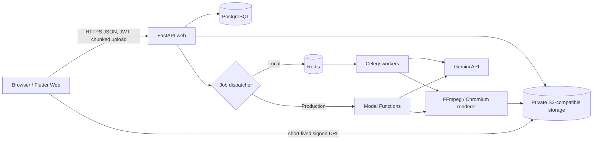
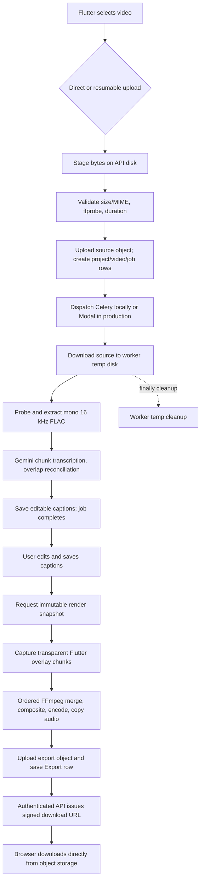
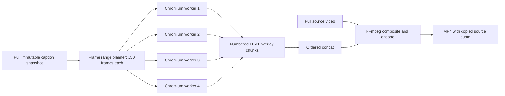

# Technical Architecture and Algorithms

> Repository review: 2026-11-14. This document describes the checked-in source and configuration. It does not assert that every configured external dependency is currently reachable. Status labels: **Implemented** means source/configuration contains the behavior; **Configured but unverified** means deployment intent is present but not validated here; **Recommended** is future work.

## Table of contents

1. [Executive summary](#1-executive-summary)
2. [System overview](#2-system-overview)
3. [Processing algorithms](#3-processing-algorithms)
4. [End-to-end pipeline](#4-end-to-end-pipeline)
5. [Caption rendering and synchronization](#5-caption-rendering-and-synchronization)
6. [Parallel rendering](#6-parallel-rendering)
7. [Resource configuration and encoding](#7-resource-configuration-and-encoding)
8. [Local development](#8-local-development)
9. [Production deployment](#9-production-deployment)
10. [Storage and file lifecycle](#10-storage-and-file-lifecycle)
11. [HTTP API](#11-http-api)
12. [Security and reliability review](#12-security-and-reliability-review)
13. [Performance and scalability](#13-performance-and-scalability)
14. [Observability](#14-observability)
15. [Tests and quality assurance](#15-tests-and-quality-assurance)
16. [Cost model](#16-cost-model)
17. [Current architecture and recommendations](#17-current-architecture-and-recommendations)
18. [Readiness checklist](#18-readiness-checklist)
19. [Prioritized roadmap](#19-prioritized-roadmap)
20. [Glossary](#20-glossary)

## 1. Executive summary

Video Caption App is a Flutter application backed by FastAPI, SQLAlchemy, PostgreSQL, S3-compatible object storage, Gemini transcription, and FFmpeg. Users upload videos, generate editable captions, adjust styles and timings in a visual editor, then export a captioned MP4. Source video and export files are private objects accessed through short-lived signed URLs. Caption generation and export are asynchronous jobs; saved edits are rendered without re-running transcription.

The local Docker path uses PostgreSQL, Redis, Celery workers, and shared temporary storage. The Modal path serves Flutter static files and FastAPI from one web function and dispatches processing and rendering to separate functions. Production rendering captures a shared Flutter caption scene in 10-second ranges using up to four Chromium threads, joins the ordered lossless overlays, composites them with the source using FFmpeg, and copies the input audio stream.

Important repository-backed risks and limits: export rendering still performs CPU-side Chromium screenshot capture even when NVENC encodes video; upload assembly temporarily writes a full local copy; API requests and multipart upload caps are configured but proxy-level limits are not visible; password reset has no production email delivery; deployment smoke evidence uses a synthetic 3-second clip, not representative long videos; and the backend test suite has not been run as part of this documentation task. There is no evidence in this review of production alerting, load shedding, queue prioritization, automatic backup/recovery verification, or representative load testing.

### System diagram

## 2. System overview

### Stack and ownership

| Layer | Implementation | Evidence / notes |
|---|---|---|
| Client | Flutter / Dart, Riverpod-style providers, go_router | `frontend/lib/main.dart`, `app.dart`, `providers/`, `routes/app_router.dart`; web and Flutter-compatible conditional IO/web sources exist. Native targets are not validated by the deployment report. |
| API | Python 3.12, FastAPI, Pydantic, SlowAPI | `backend/app/main.py`, `backend/schemas/schemas.py`, `backend/app/limiter.py` |
| Database | SQLAlchemy async API + sync workers; PostgreSQL in Compose; Alembic | `backend/app/database.py`, `backend/models/models.py`, `backend/alembic/` |
| Queue | Celery + Redis locally; Modal function calls in deployed mode | `backend/workers/task_queue.py`, `celery_app.py`, `modal_app.py` |
| Media | FFmpeg/ffprobe, Chromium, Playwright, Flutter scene, optional NVIDIA NVENC | `backend/services/{ffmpeg_service,flutter_render_service,video_encoder}.py`; `backend/Dockerfile` |
| AI | Gemini HTTP API via `httpx` | `backend/services/gemini_service.py` |
| Object store | boto3 S3 API, endpoint configurable (deployment report says Cloudflare R2) | `backend/services/storage_service.py` |
| Frontend export scene | Separately built Flutter web entrypoint | `frontend/lib/render_main.dart`; Docker builds `main.dart` and `render_main.dart` |

### Data and job model

`User` owns `Project`; a project has a `Video`, caption data, processing jobs, and exports. `ProcessingJob` persists status, stage, progress, error, scheduler call ID (column retains historical name `celery_task_id`), immutable render snapshot, and render diagnostics. `UploadSession` records resumable upload metadata and owner. `PasswordResetToken` stores only a hash, expiry, and used state. See `backend/models/models.py` and migration history.

Authentication is email/password with bcrypt hashes and HS256 JWTs (default 60-minute expiry). The API checks project ownership and returns 404 for inaccessible resources. Browser token persistence is implemented by `frontend/lib/core/storage/token_storage.dart`; web and native storage differ by conditional implementation.

## 3. Processing algorithms

| Technique | Implementation and behavior | Complexity / failure / limits |
|---|---|---|
| Resumable upload | `frontend/lib/core/chunked_uploader.dart`; `backend/routes/chunked_upload_routes.py`; `services/chunked_upload_service.py`. Computes `ceil(file_size/chunk_size)`, sends chunks independently, retries and asks status after reconnect; backend overwrites same index, validates expected size, and assembles in increasing index order. Default 5 MiB; accepted configured chunk size 1–50 MiB. | O(file bytes) I/O and local temporary disk. No content hash or per-chunk integrity checksum evident. Object-storage backend makes chunks available across Modal API containers. Assemble still materializes full source locally. |
| Upload validation | `validation_service.validate_upload_basics`, `ffmpeg_service.probe_video` and `validate_duration`. Declared MIME allowlist and byte limit are checked; ffprobe must find video and positive duration, source duration capped at configured 3600s default. Safe server-generated storage filename is based on job ID. | ffprobe cost scales with container/stream metadata, not full decode in normal case. Declared MIME is not proof of content; malformed media can still stress parsers. `sniff_container()` exists, but caller use must be confirmed against all paths before treating it as a content-signature gate. |
| Metadata extraction | `ffprobe -show_format -show_streams -print_format json`; extracts duration, resolution, sample aspect ratio, rotation, average frame rate, bitrate, codecs, pixel format, and audio presence. | Parsing O(number of stream/metadata fields); bad or incomplete metadata fails with user-safe ValueError. Rotation is used to normalize dimensions, not necessarily to normalize every source frame transform. |
| Audio extraction | `ffmpeg_service.extract_audio`: FFmpeg decodes source audio to mono 16 kHz FLAC on disk (`-ac 1 -ar 16000 -vn`). No-audio videos are rejected before transcription. | Runtime proportional to media duration/audio complexity; disk proportional to compressed audio size. Audio extraction errors are logged and surfaced generically. |
| Long-audio chunk plan | `gemini_service.plan_chunks` uses configured 600-second chunks and 5-second overlaps. `_extract_chunk_audio` cuts each range. Chunks transcribe concurrently under `asyncio.Semaphore(gemini_max_concurrency)` (default 2). | O(duration) total audio; peak chunk work bounded by semaphore, although all results are gathered. Chunk completion order does not affect output ordering. |
| Gemini transcription and retry | `_call_gemini_once`, `_transcribe_chunk_with_retry`: HTTP JSON request with audio, typed Pydantic validation, transient errors (429/5xx) use bounded exponential waits; malformed response is retried; permanent HTTP error is not. Prompt correction can be used for invalid transcript output. | External latency/cost dominates. Retries can repeat calls; `chunk_cache_key()` exists as a deterministic hash helper, but inspection did not establish persistent cache read/write integration, so cached transcription is **not confirmed**. |
| Overlap reconciliation | `_reconcile_chunks`: add actual slice start offset to segment/word times; drop segments wholly before later chunk's intended start; sort by global start. `_fit_words_inside_segment` repairs generated zero/short word intervals by clamping and reserving positive duration. | O(number of transcript segments log segments) due to sort; proportional memory to transcript size. Partial overlap duplicates that extend past the keep boundary may remain; no forced alignment pass. |
| Translation / script conversion | `translate_transcript` batches up to 30 segments, preserves segment times, assigns translated word timing by character-count shares over original segment duration; `change_transcript_script` requires same word count and retains each original word timing. | O(number of words) plus external calls. Translation word timing is explicitly approximate, not forced alignment. |
| Caption selection/layout | `frontend/lib/widgets/caption_scene.dart` chooses segment at quantized 15 fps time (`floor(t*15)/15`), then active word interval; segment or global style overrides position, scale, rotation, language font and RTL direction. Word grouping/layout is in caption model helpers. | Current segment search is linear per captured frame (O(segments × frames)); overlap prevention between separate caption segments is not clearly enforced by the renderer. Text layout is Flutter, not ASS. |
| Render cache identity | `render_scene.caption_snapshot` includes renderer/pipeline version, caption data/style/aspect ratio/FPS; canonical JSON SHA-256 fingerprint. Render request reuses matching completed export. | Hash cost O(snapshot bytes). Cache is output-record reuse, not a general frame/cache subsystem. Export profile fields also participate in reuse matching. |
| Overlay frame capture | `flutter_render_service.render_scene`: total overlay frames `ceil(duration×15)`; split into consecutive 150-frame / 10-second ranges; up to four worker threads each reuse one Chromium runtime. Per-frame Flutter scene time is absolute `frame/15`; screenshot PNG bytes stream to FFmpeg FFV1/BGRA MKV per range. | O(frames × overlay pixels) screenshot/compositing work; PNG pipe traffic and Chromium dominate potential cost. Worker count bounded at four inside each render function. A failed future aborts render; partial intermediates are cleaned in task directory finally. |
| Ordered merge and encode | Overlay chunks are numbered and concatenated in frame-range order using FFmpeg concat demuxer (see render service); source and overlay filtered/scaled then overlaid; optional glass treatment uses blur/mask; output H.264, yuv420p, source audio mapped with `-c:a copy`, `+faststart`. | Encoding/compositing scales with source frames and output pixels; selected encoder influences throughput/quality/file size. Merge correctness depends on exact adjacent frame ranges and ordered chunk list. No distributed chunk render across Modal containers is implemented. |
| Cleanup/cancellation | Worker checks DB cancellation at stage boundaries and progress callbacks; task directory removed in `finally`; cleanup sweeps old temp directories and abandoned upload sessions. Modal recovery checks remote call results. | Cancellation is cooperative during Python-driven work and does not guarantee immediate interruption inside a currently blocked external process. Temporary cleanup is best effort. |

Not found / not established: a reusable media probe cache, persistent Gemini chunk cache, distributed render queue with per-chunk retries, forced audio alignment, upload checksum validation, independent frame-level checkpoint recovery, or a download-preparation/transcode job distinct from rendering.

## 4. End-to-end pipeline

Upload, validation, object upload, and database setup run in the API request. Transcription and rendering run asynchronously in separate worker processes/Modal calls. Caption editing and preview are API/UI interactions; preview uses the original video via a signed URL and overlays captions in Flutter. Final video export is lazy: initial transcription does not also render a video. Export download is a redirect-by-URL handoff, not a backend proxy transfer.

## 5. Caption rendering and synchronization

The actual export renderer is Flutter Canvas/widget rendering in an offline Flutter web build (`frontend/lib/render_main.dart` and `caption_scene.dart`) hosted in headless Chromium through Playwright. It is not the ASS renderer described in legacy comments in `ffmpeg_service.py`; current `tasks.rerender_project_job` calls `flutter_render_service.render_scene`. ASS helpers in `ffmpeg_service.py` remain in source, but they are not the current export path evidenced by this call chain.

Caption data is JSON with segment and word start/end seconds and style metadata. The scene selects a segment where `start <= quantized_time < end`. At 15 FPS the visible state changes in 66.67 ms increments. Word highlighting/karaoke uses active word intervals. Presets/overrides can change color, font, size, position, scale, rotation, motion and style; see `caption_scene.dart`, `caption.dart`, and `template_catalog.py`. Fonts are bundled in `frontend/assets/fonts`; the worker routes the Roboto webfont request to a local bundled file and blocks other external requests. Arabic/Urdu font and RTL selection uses script/language checks.

The overlay canvas fits within 720 px maximum dimension; the final composite scales it to output dimensions with Lanczos. Video output preserves source frame timestamps via `-fps_mode passthrough` unless output settings request a different FPS; output resolution/aspect options are handled by `output_dimensions`. Overlay sampling remains 15 fps. The code does not document a dedicated variable-frame-rate normalization stage; passthrough aims to retain source timing, but mixed VFR behavior should be validated with fixtures. Source playback/editor preview and rendered export share the Flutter scene/versioned snapshot, reducing preview/export style divergence.

**10-second boundary case (implemented):** a segment from 9.3 s to 11.7 s is active at global frame times on both sides of frame 150 (10.0 s). Chunk 0 captures frames 0–149; chunk 1 starts at frame 150. Every worker loads the same full transcript snapshot, and `captionSetTime(frame / 15)` uses global time rather than chunk-relative time. Thus the caption is absent before 9.3 s, continues across the boundary, and ends at 11.7 s. A stateful animation tied to absolute scene time should remain continuous; any animation keyed to widget lifecycle could restart because each worker reloads a scene per chunk. The supplied implementation uses time-based scene evaluation; animation continuity for every effect should still be confirmed with a rendered boundary fixture. This is independent per-chunk capture, not source-video chunking.

## 6. Parallel rendering

Ranges are contiguous `[start, min(start+150, frame_count))`, assigned round-robin to workers, named by stable index and merged in list order. This prevents planned gaps/reordering; there is no explicit per-frame checksum or duplicate-frame detector. Each worker has its own thread-local browser, serially handles assigned chunks, and closes its runtime on exit. Thread count is `min(4, range_count)`. Modal render function permits at most one container per selected profile; this is not four Modal workers: the four-way parallelism is within that container. Local render Celery worker concurrency is one in Compose.

No independent chunk retry or distributed intermediate object store exists. A chunk failure fails the parent render and requires another render job. Original audio is not split; it is muxed once from the complete original source, avoiding chunk audio seam/ordering issues. Concurrent file names are job-specific work directories. Modal worker startup/teardown is managed by the platform; application code closes Chromium at worker completion and process exit.

## 7. Resource configuration and encoding

| Path/function | CPU / RAM | Concurrency / timeout | GPU | Notes |
|---|---:|---|---|---|
| Modal `web` | 1 core / 2 GiB | max 2 containers, max 16 inputs/container | none | scales to zero; cold-start possible |
| Modal `process_video_job` | 1 / 2 GiB | max 4 containers, 7200s, retries 0 | none | audio extraction + Gemini |
| Modal `rerender_project_job` | 4 / 8 GiB | max 1 container per profile, 1800s, retries 0 | auto list T4/L4/A10 (profile ordering adjusted in task dispatch), or explicit/none | internal overlay threads max 4; one active render per user enforced in API |
| Modal cleanup | 0.25 / 512 MiB | every 15 min; max 1; 600s | none | removes stale files and checks job recovery |
| Local API | Compose: 4 Uvicorn workers | Gunicorn timeout 120s | none | shared temp volume |
| Local process workers | Compose: Celery concurrency 2 | Redis broker | none | shared temp volume |
| Local render worker | Compose: concurrency 1 | render queue | none by default | Chromium and FFmpeg image |

`CAPTION_VIDEO_ENCODER=auto` in Modal performs an actual test encode and chooses NVENC if usable, otherwise warns and falls back to libx264. Explicit `h264_nvenc` fails if unavailable. NVENC uses VBR with `-cq` and `-b:v 0`; libx264 uses preset and CRF. Quality values are not numerically comparable across encoders. Local default encoder is `libx264` unless environment overrides it. The code also allows GPU-less Modal deployment (`MODAL_RENDER_GPU=none`). GPU encoding accelerates encoding only; Chromium rasterization/screenshots and some filters remain CPU-bound/software graphics.

Audio preservation requirement: **implemented for normal supported muxing**. Final command maps optional input audio (`0:a?`) and uses `-c:a copy`; it does not re-encode AAC/etc. Incompatible audio/container combinations or malformed inputs may cause mux failure; no fallback audio re-encode is shown. Validate output audio codec/duration across supported input formats.

A 16 MB source can yield a 48 MB output because video is decoded and re-encoded with a target quality policy rather than copied; high source compression, noise/motion, resolution/FPS changes, CRF/CQ choice, encoder preset, and codec can raise average bitrate. Audio copy is not the likely cause of a tripling. A rough size estimate is `duration × (video bitrate + audio bitrate) / 8`, plus container overhead. No file-size cap or two-pass target bitrate path is evidenced.

Quality recommendations (configuration proposals, not current measured results):

| Goal | Suggested starting point | Trade-off |
|---|---|---|
| Small | H.264 CRF 26–30, slower preset; keep source dimensions/FPS; AAC only if copy impossible | Smaller, more visible loss on motion/textures |
| Balanced | H.264 CRF 20–24, medium preset; source dimensions/FPS | General compatibility and quality |
| High | H.264 CRF 17–20 or tested NVENC CQ equivalent; slower preset where CPU budget permits | Larger output and compute; compare visually rather than equating CRF/CQ |

These are engineering starting ranges, not repository defaults or benchmark claims. AV1/H.265 support is not established by the export command, which selects H.264 only.

## 8. Local development

Requirements indicated by source: Flutter 3.27+, Python 3.12, Docker Compose, FFmpeg/ffprobe, Chromium (container image), and configured Gemini/storage credentials. `frontend/run_web.ps1` runs `flutter pub get`, then the Chrome dev server (default port 9000) with API base URL default `http://localhost:9001`. It preserves generated files across restarts; use `flutter clean` manually only when a clean rebuild is needed.

`run_docker_local.ps1` requires `backend/.env`, then composes `docker-compose.yml` with `docker-compose.local.yml`: PostgreSQL and Redis, API on host port 9001, Nginx-served Flutter frontend on host port 9000, Celery processing/render workers, Beat cleanup, shared temp volume. DB/Redis service health gates API startup; API health gates frontend startup. The Flutter release bundle is built into the image, before Nginx listens. Backend API runs migrations and Gunicorn/Uvicorn workers in standard Compose. Local override forces Celery and local chunk storage. `docker-compose.modal-local.yml` is a distinct optional local API-to-Modal setup; it uses configured DB URL and Modal credentials, and disables local Celery services by profile.

`backend/start_service.py`, `start_worker.py`, `workers/celery_app.py`, and Compose commands define API/worker startup. Settings are loaded from environment/`.env` via `backend/app/config.py`; `backend/.env.example` and `frontend/.env.example` list names but must not be copied into docs with values. The API defaults CORS to localhost:3000; local override permits localhost:9000 and 127.0.0.1:9000. Compose service names (e.g. `postgres`, `redis`) resolve inside Compose, not from host processes.

**MIME troubleshooting scenario:** `Refused to execute script from /web_entrypoint.dart.js because its MIME type (text/html) is not executable.` This means the browser requested a Flutter debug JavaScript file and received HTML instead, typically while the debug compiler has not produced that file yet or a fallback serves `index.html` for the missing URL. The local container now serves a prebuilt release bundle through Nginx; it has no `web_entrypoint.dart.js` and returns 404 for missing static assets. The standalone Flutter dev script no longer deletes generated artifacts on each run. If the error appears again, confirm which process owns port 9000 and inspect that request's response in the browser Network panel.

## 9. Production deployment

`deploy_modal.ps1` creates/reuses `.venv-modal`, installs `requirements-modal.txt`, loads the selected dotenv file into a named private Modal Secret, runs the one-off `migrate` function, then deploys `modal_app.py`. `backend/Dockerfile` is multi-stage: Flutter builds production web and a separate renderer; Python 3.12 image installs FFmpeg, Chromium, fonts, backend requirements, and copies both artifacts. Modal web and API share one origin; frontend static assets are served by FastAPI. This is a single deployment surface, while jobs execute in independent Modal functions.

Production settings include existing PostgreSQL, private S3-compatible storage (deployment report identifies Cloudflare R2), and Gemini. Secrets are injected from Modal Secret; the deployment script uploads `.env` content but secret values are intentionally not repeated here. Migrations run once before deploy rather than each web container startup. Modal function GPU/concurrency/timeouts are in `modal_app.py` and summarized above. Browser assets are built into image; runtime `web()` sets public URLs and CORS origin from Modal URL or `PUBLIC_APP_URL`.

Configured behavior is not a guarantee of availability. The repository includes a deployment verification report dated 2026-11-11, documenting a successful smoke deployment, including synthetic 3-second upload/transcription/export, an A10 hardware encode check, private signed download and browser decode. It reports 83.234s caption job, 31.281s export observed by polling, and 12.362s internal renderer time for that tiny clip. These are measured smoke values for that run, not general performance estimates. The report explicitly says correctness was established, not comparative speed. It also notes direct browser fetch CORS from object storage is not enabled; current download navigates to a signed URL.

Likely production constraints: web cold start; max four simultaneous transcription containers; one render container per GPU profile and one active render per user; upstream Gemini/network latency; CPU screenshot/composite bottleneck; two-hour process job and 30-minute render cutoff; DB/object-store dependencies share availability fate; no automated multi-region/failover setup evidenced.

## 10. Storage and file lifecycle

1. Upload bytes arrive at a UUID-named local staging file; browser-supplied name is metadata only.
2. Resumable upload chunks are local files for Compose, private `upload-chunks/{upload_id}/` objects for Modal. Session row stores owner, size, MIME, chunk geometry, language options and status.
3. Complete assembles chunks in order to a temporary full file, validates, probes, uploads source to `uploads/{project_id}/{safe filename}`, removes local assembled file, then persists Video/Project/Job references.
4. Worker downloads source to `/tmp/caption_app/processing/{job_id}/source.mp4`; extraction, render intermediates, logs and output are job-local. Render overlays are local numbered MKV chunks; no cross-container intermediate store.
5. On successful render, worker uploads `exports/{project_id}/{job_id}.mp4`, persists Export row, then removes job workdir.
6. Authenticated preview/export endpoints verify project ownership and issue signed URLs (preview 30 minutes, export download 1 hour). File bytes transfer from object storage to browser.
7. Chunk objects are removed after completion/cancel; scheduled cleanup removes stale sessions/temp files. Deleting project explicitly deletes source object and database cascades records; export-object deletion on project deletion is not evident in `project_routes.py`, a possible orphan-storage issue. Export expiration fields exist but no general export expiration policy is established by this review.

Object keys use UUID project/job identifiers, not raw path traversal strings. S3 transfer config uses multipart threshold/chunk size 8 MiB and concurrency 4. Upload assembly downloads each object chunk locally and copies it into a combined file; direct streaming across storage/worker could reduce temporary I/O, but must preserve ordered validation and retry semantics. Persistent temporary usage limits/quota enforcement are not evident.

## 11. HTTP API

All routes are mounted by `backend/app/main.py`. Unless stated public, routes below require bearer JWT. Ownership failures generally return 404 to avoid exposing resource existence. Schemas are in `backend/schemas/schemas.py`; unhandled errors are logged and return generic 500.

| Method and path | Auth | Purpose / behavior |
|---|---|---|
| `POST /api/auth/register` | Public; rate limited | Email/password validation; 201 JWT. Duplicate email 409. |
| `POST /api/auth/login` | Public; rate limited | JWT; bad credentials 401. |
| `GET /api/auth/me` | Required | User ID/email/plan/created time. |
| `POST /api/auth/forgot-password` | Public; rate limited | Always 202 generic response; token hash stored. No production mail provider wired. |
| `POST /api/auth/reset-password` | Public; rate limited | Single-use 30-minute token, new password 8–128 chars. Invalid/expired 400. |
| `POST /api/videos/upload` | Required; rate limited | Single multipart upload, project name/language/translate options; 201 project/job IDs. MIME 415, size 413, validation 422. Not resumable. |
| `POST /api/uploads/init` | Required; upload rate limit | Creates owned resumable session; input filename/MIME/size/name/language/translation/chunk size. MIME 415, oversized 413. |
| `PUT /api/uploads/{id}/chunks/{index}` | Required + session owner | Streams one request body to temp then persists chunk. Index/size/empty validation. |
| `GET /api/uploads/{id}/status` | Required + owner | Received indices, total and completion status. |
| `POST /api/uploads/{id}/complete` | Required + owner | Requires all chunks, ordered assemble, common validation/finalization, enqueue. Missing chunks 400; validation 422. |
| `DELETE /api/uploads/{id}` | Required + owner | Cancel and clean partial chunks. |
| `GET /api/jobs/{id}` | Required + project owner | Status, stage, progress, error, creation time. |
| `POST /api/jobs/{id}/cancel` | Required + owner | Persist cancel state, attempt queue cancellation; completed job 400. |
| `GET /api/projects/{id}/jobs/latest` | Required + owner | Most recent job state for project. |
| `GET /api/projects` | Required | Owned project list. |
| `GET /api/projects/{id}` | Required + owner | Project summary. |
| `DELETE /api/projects/{id}` | Required + owner | Delete source object and DB project/cascades. Export object cleanup needs review. |
| `GET /api/projects/{id}/video/preview-url` | Required + owner | 30-minute signed source-video URL. |
| `GET /api/projects/{id}/captions` | Required + owner | Caption track/style and matching render fingerprint/export ID. |
| `PUT /api/projects/{id}/captions` | Required + owner | Validates and saves edited transcript, styles, aspect ratio. |
| `POST /api/projects/{id}/captions/translate` | Required + owner | Gemini translation; 422 invalid input, 502 model failure. |
| `POST /api/projects/{id}/captions/script` | Required + owner | Convert writing script; 422/502 on validation/model error. |
| `POST /api/projects/{id}/render` | Required + owner | Reuse matching completed export or enqueue render snapshot; one active render per user. |
| `GET /api/projects/{id}/exports` | Required + owner | Export metadata list. |
| `GET /api/exports/{id}/download` | Required + owner | Fresh 1-hour signed attachment URL. |
| `GET /api/usage` | Required | Usage summary. |
| `GET /api/caption-templates` and `/{template_id}` | Public | Approved template catalog/manifest. |
| `GET /api/health` | Public | Static `{"status":"ok"}`; not a dependency readiness check. |
| `GET /api/config/public` | Public | Safe upload limits/MIME and default chunk size. |
| `GET /api/diagnostics/system` | Required | Read-only DB/queue/storage/FFmpeg/temp disk and available memory checks. |
| `GET /api/diagnostics/gemini` | Public but development-only | Calls Gemini; hidden as 404 outside development. |
| `GET /api/diagnostics/jobs/{id}/render` | Required + owner | Render diagnostics; implementation also guards development mode where configured. |
| `GET /api/docs`, `/api/redoc`, `/api/openapi.json` | Public | FastAPI docs/OpenAPI. |

Rate limiting is explicit on login/register/reset endpoints and upload creation/direct upload; repository does not show a general per-user API limit. Client API calls are centralized in `frontend/lib/core/api_client.dart`; providers manage auth/projects/jobs/captions/exports. Upload uses `chunked_uploader.dart`; job progress is polled rather than server-pushed.

## 12. Security and reliability review

Severity reflects source-level risk, not a penetration-test result.

| Severity | Finding / evidence | Recommendation |
|---|---|---|
| High | Max upload defaults to 2 GiB and video duration to 1 hour; concurrent uploads and render work can consume substantial temp disk/CPU. No user storage quota or global admission/backpressure is evident. | Add per-user/project quotas, global concurrency/admission limits, disk headroom checks and request/proxy body limits. |
| High | Forgot-password creates valid token but production email sending is explicitly absent; token is not logged outside development. Function is non-deliverable in production. | Integrate email delivery, rotate/invalidate older reset tokens, monitor delivery and rate limit by IP/email. |
| Medium | HTTP Basic JWT controls; bearer token and bcrypt are implemented, ownership checks frequent. No refresh/revocation mechanism evidenced; token remains valid until expiry. | Add refresh/revocation strategy and key rotation procedure; enforce HTTPS at edge. |
| Medium | MIME allowlist and ffprobe checks are present, staging names are generated, FFmpeg commands use argument arrays, API path fallback constrains resolved paths. These mitigate common risks but do not replace content scanning/sandboxing. | Add signature/container allowlist, parser resource/time limits, adversarial media tests, and verify FFmpeg subprocess timeouts. |
| Medium | S3-compatible private storage and signed URLs (30/60 min) support access control. Bucket policy/IAM details are external and unverified. | Verify bucket privacy, least-privilege credentials, lifecycle policies and signed URL leakage/referrer behavior. |
| Medium | User-facing unhandled errors are generic; worker logs include exceptions. Development reset tokens are logged only in development. | Ensure log access/retention controls; redact user data and avoid user-supplied content in logs. |
| Low/Medium | CORS origins configurable; Modal sets deployed origin. `allow_methods/headers` broad and credential support enabled. | Set explicit methods/headers and verify production origin list. |
| Unverified | Dependency vulnerability scanning, build provenance, CI release gating, security headers, CSRF posture, alerting and backup restore tests are not established by inspected files. | Add automated supply-chain/security checks and operational verification. |

`validate_caption_configuration` limits allowed templates and caption payload size/segment/word/timing shape. FFmpeg receives a server-created command list, not a shell string. However, request-level file size and MIME checks should be supplemented by infrastructure-level limits because API/proxy behavior is not documented here.

## 13. Performance and scalability

Existing optimization: resumable upload; stream-to-disk staging; multipart object transfers (8 MiB chunks, concurrency 4); short-video transcription avoids redundant audio chunk encode; long audio uses bounded Gemini concurrency and overlap; render uses direct Chromium screenshots to avoid older Flutter raster+Base64 path, persistent browsers per worker thread, 720p-capped overlays, up to four local render threads, export fingerprint reuse, lazy render, source audio copy, NVENC actual capability probe, and diagnostics phase timing.

Scaling is bounded by Modal container caps, per-user active render policy, and Modal GPU profile cap. Local Celery has fixed worker concurrency. No evidence of queue priorities, global backpressure, load shedding, distributed render chunk scheduling, CDN cache, database pool tuning benchmark, or upload bandwidth acceleration. Web function's `max_inputs=16` does not imply 16 simultaneous heavy renders; rendering is dispatched elsewhere.

Measure separately: upload MiB/s; queue wait; source download; ffprobe; audio extraction; Gemini per chunk and retries; scene/browser startup; screenshot frames/s; pipe MB/s; FFmpeg composite/encode frames/s; object upload; end-to-end time; output/input byte ratio; peak RSS/temp-disk; CPU/GPU utilization; cost/video. Compare same input/profile repeatedly and report p50/p95, warm/cold, queue wait separated, and visual/audio correctness. The existing deployment report's tiny synthetic run is a smoke test, not representative benchmark data.

## 14. Observability

Implemented: Python logging; generic exception boundary; job status/stage/progress; job IDs; render diagnostics with source/output metadata, frame counts, encoder, FFmpeg command with source/output path redaction, phase durations, capture worker/chunk data, FFmpeg progress parsing; health endpoint; development authenticated system diagnostics check DB, queue/Modal functions, storage, FFmpeg, writable temp disk, and cgroup memory. Modal cleanup calls `recover_finished_jobs`; local startup recovers orphaned jobs.

Not evidenced: external error aggregation, request tracing/correlation IDs across API and Modal, Prometheus/OpenTelemetry metrics, alert rules/SLO dashboards, GPU utilization time series, readiness endpoint that gates on dependencies, or automated stuck-queue alerting. `/api/health` only returns `ok`, so it should not be interpreted as full readiness.

## 15. Tests and quality assurance

Backend tests include validation, chunk upload routes/storage, object-storage uploads, Modal route/job/recovery behavior, encoder selection, render snapshots, templates, auth/usage limits, Gemini generation, startup, and pipeline performance. Flutter tests include widget, caption render state, model/chunk source. The 2026-11-11 deployment report records 84 backend tests passed / 1 skipped in Modal-dispatch mode, 4 focused encoder tests, Flutter production builds, and live synthetic smoke checks. These are recorded historical results, not rerun for this document. Coverage percentage is not established.

Recommended QA matrix: unit tests for timeline boundary/effect continuity and translation timing; integration tests with real ffprobe/FFmpeg fixtures, source audio codec preservation, VFR/rotation/aspect ratio; API ownership/rate/oversize tests; storage cleanup and failed upload; cancellation while subprocess runs; concurrency and worker crash/recovery; signed URL expiry; hostile filenames and malformed media. Add representative 30-second, 60-second, 3-minute and 30-minute fixtures, asserting caption timing, frame count/order, audio stream codec/duration, output decodability, and resource ceilings. Do not infer performance from synthetic tiny clips.

## 16. Cost model

No live pricing is embedded here. Use actual Modal/storage/provider invoices and measured durations. Per export estimate:

`cost ≈ (CPU core-seconds × CPU rate) + (RAM GiB-seconds × RAM rate) + (GPU seconds × GPU rate) + storage GB-month + request/transfer charges + Gemini input/output usage`.

For Modal functions, calculate CPU/RAM/GPU usage over billed runtime, including cold start and failed calls; divide by successful exports. Separately account source download, output upload, temporary storage duration, object request count, and Gemini chunk/retry calls. Compare actual billing with job IDs and timestamps. Cost drivers in code are GPU render runtime, Chromium screenshots/composite CPU time, large media transfer, Gemini retries/chunks, and abandoned temp/upload objects. `retries=0` on Modal worker functions avoids platform retries but means failed jobs require user retry; Gemini has its own retry loop. GPU can fall back across types for availability but changes actual rate and runtime.

## 17. Current architecture and recommendations

| Component | Current implementation | Problem or limitation | Recommended improvement | Priority |
|---|---|---|---|---|
| Frontend | Flutter web and conditional platform code; shared caption scene | Native target support/build matrix not demonstrated | CI builds/tests for each supported target; measure upload resume behavior | P2 |
| API | FastAPI, ownership checks, JWT, rate-limited selected endpoints | General rate limits/admission not evidenced | Per-user/IP limits and overload responses | P1 |
| Transcription | Gemini chunking with overlap, bounded concurrency, reconciliation | No persistent cache integration established; translation timing approximate | Persist idempotency/results and test alignment quality | P2 |
| Rendering | 10s frame ranges, 4 Chromium threads inside one worker, ordered FFV1 overlay merge | Screenshot path remains software/CPU; no chunk retry/checksum | Profile bottlenecks, add chunk integrity/retry only if complexity justified | P1 |
| CPU/GPU | T4/L4/A10 options; NVENC probe/fallback | GPU does not accelerate browser capture; capacity/cost varies | Profile CPU-only vs NVENC on representative jobs | P1 |
| Concurrency | One active render/user; Modal container caps | No queue backpressure/prioritization or global quotas | Add admission control and queue-age/load-shed policy | P1 |
| Storage | Private S3-compatible objects, signed links, temp cleanup | Project deletion visibly deletes source but export-object cleanup is unclear; upload assembles full copy | Delete all project objects transactionally/outbox; evaluate multipart streaming | P1 |
| Security | bcrypt/JWT, ownership, MIME/size/duration checks, safe temp names | No production password reset delivery; resource exhaustion limits incomplete | Email/reset flow, quotas, proxy limits, dependency scans | P0 |
| Performance | Diagnostics and reuse fingerprint; worker configs | Only tiny smoke performance evidence | Benchmark representative durations/profiles; establish SLOs | P1 |
| Deployment | Modal serves frontend/API; separate workers; one-off migrations | External dependencies/backups/alerts not verified | Readiness checks, rollback/migration plan, restore drill, alerting | P1 |

## 18. Readiness checklist

| Item | Status | Evidence / limitation |
|---|---|---|
| Core upload/transcription/edit/export flow | Passed (smoke) | Deployment report, synthetic clip only; not broad format coverage |
| API ownership checks and JWT | Implemented; security review unverified | Source checks present; no penetration test |
| Chunked upload resume | Implemented | Unit/integration test files and report smoke test |
| Caption timing and chunk-boundary continuity | Partially verified | Global frame time in code; dedicated export boundary fixture not evidenced here |
| Audio copy in exports | Implemented; format coverage unverified | FFmpeg maps source audio and `-c:a copy` |
| Modal GPU/NVENC | Passed for reported deployment snapshot | Actual A10 probe passed then; runtime may differ |
| Resource limits | Configured | Modal CPU/RAM/GPU/timeouts; not load-tested |
| Storage privacy/signed URLs | Configured and smoke-tested | Bucket policy details external |
| Production password reset | Failed/incomplete | No email sender wired |
| Dependency readiness health | Failed/incomplete | Public health endpoint only returns `ok` |
| Monitoring/alerts/tracing | Unverified / not evidenced | Diagnostics/logs exist; no alert config found |
| Backup and recovery | Unverified | No restore drill evidence in repository |
| Queue backpressure/load shedding | Not implemented/evidenced | Fixed caps only |
| CI/CD security and release gating | Unverified | No workflow files found in inventory |
| Representative load/performance testing | Unverified | Historical report explicitly only tiny smoke test |
| Automated tests | Implemented | Tests exist; historical report gives result; not run during this task |

## 19. Prioritized roadmap

| Phase / priority | Improvement | Benefit and complexity | Files / dependencies | Validation |
|---|---|---|---|---|
| Phase 1 — P0 | Complete production password reset delivery and token lifecycle | Enables recovery; medium complexity; email provider dependency | `backend/routes/auth_routes.py`, config, provider integration | End-to-end delivered email, expiry, reuse, enumeration and rate-limit tests |
| Phase 1 — P1 | Enforce quotas/admission and proxy request limits | Protects disk, CPU/GPU and API from exhaustion; medium | config, upload routes, job dispatch, deployment edge | Concurrent large-upload/render tests; verify bounded disk and queue |
| Phase 1 — P1 | Ensure deleting project removes source, exports and related object prefixes | Prevents orphan storage cost/data retention; low-medium | `project_routes.py`, storage service; consider durable cleanup/outbox | Delete project, verify object listing empty despite transient failure |
| Phase 2 — P1 | Benchmark render pipeline by stage on representative videos and profiles | Finds whether screenshots, filters, encoding or transfer dominate; medium | `flutter_render_service.py`, diagnostics, perf reports | Repeated 30s/60s/3m/30m runs, p50/p95, RSS, disk, quality, cost |
| Phase 2 — P2 | Add deterministic chunk boundary/frame/audio fixtures and cancellation tests | Prevents visual discontinuities and silent regressions; medium | Flutter scene tests, `test_render_snapshots.py`, renderer | Validate frame indexes 149/150/151 and 9.3–11.7s segment; decode audio/video |
| Phase 3 — P1 | Add dependency/security scanning and verify bucket/IAM/HTTPS/security headers | Reduces supply-chain and data-access risk; medium | requirements, Docker/deploy, storage policy | CI scan plus external configuration review and negative access tests |
| Phase 3 — P1 | Add dependency-aware readiness, structured request IDs and alerting | Faster incident detection/recovery; medium | `main.py`, workers, Modal logs/monitoring | Simulate DB/queue/storage failures and confirm alarms/readiness behavior |
| Phase 4 — P2 | Add queue age metrics, backpressure and priority policy | Predictable latency under growth; medium-high | `task_queue.py`, Celery/Modal dispatch, DB | Load test, verify bounded queue and user-visible overload responses |
| Phase 4 — P2 | Reduce duplicate full-file copies where practical | Lower local disk and I/O pressure; medium-high | chunk upload and storage services | Compare peak disk/throughput and verify resume/validation unchanged |
| Phase 4 — P3 | Cost-aware export profiles and storage lifecycle automation | Lower cost and reduce abandoned data; medium | export options, Modal config, bucket lifecycle | Invoice reconciliation per successful render and deletion/expiry audit |

## 20. Glossary

| Term | Meaning |
|---|---|
| ASS | Advanced SubStation Alpha subtitle format; legacy helpers exist, but current export uses Flutter scene capture. |
| CQ / CRF | Constant-quality controls used by NVENC / x264 respectively; values are not directly equivalent. |
| FFV1 | Lossless codec used for intermediate transparent caption overlay chunks. |
| Fingerprint | SHA-256 of canonical render snapshot used to detect reusable matching exports. |
| Modal call ID | Remote worker invocation ID stored in legacy-named `celery_task_id` field. |
| NVENC | NVIDIA hardware video encoder; runtime availability is tested by actual encode. |
| Signed URL | Time-limited object-store URL granting access to a private object. |
| VFR | Variable frame rate; source timestamps may not be uniformly spaced. |
